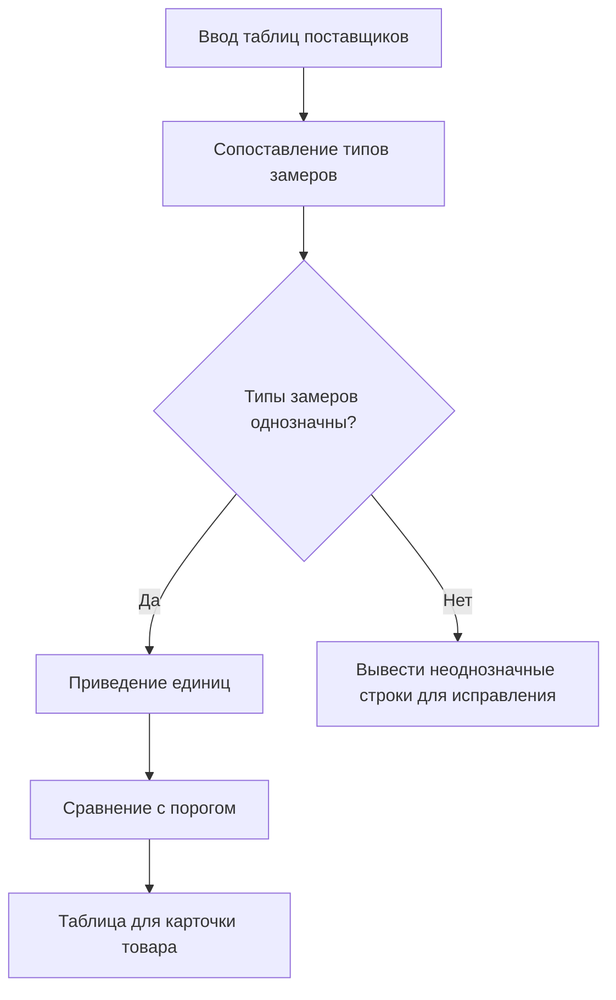

# 220 · Сравнение размерных сеток поставщиков

Репозиторий `size-chart-comparator` · браузерное приложение

**Продукт и интерфейс.** Продавец вводит замеры товара для нескольких поставщиков и размеров. Таблица показывает, какие различия скрываются за одинаковой маркировкой, и позволяет подготовить отдельную таблицу замеров для карточки товара.

**Архитектура и данные.** React, TypeScript и IndexedDB. Сущности — поставщик, модель, размер, тип замера, значение и единица измерения. Сантиметры и дюймы приводятся к единой шкале с заданным округлением. Пропуск показывается отдельно. Превышение заданного пользователем порога подсвечивается. Экспорт — CSV и печатная таблица. Сервер и ML не нужны.

**Блок-схема основного сценария**

**Функциональные правила.** Сопоставлять только одинаковые типы замера и одинаковый способ измерения. Переводить значения в целые миллиметры, считать максимальный разброс по выбранной группе, подсвечивать строгое превышение порога. Отсутствующие поля не участвуют в расчёте.

**Контракты реализации.** Модули `chart-editor`, `unit-conversion`, `measurement-compare` и `chart-export`. Для вывода указывать единицу и формат замера явными подписями.

**Проверки граничных случаев.** Проверить смешанные сантиметры и дюймы, значение ровно на пороге и конфликт двух строк с одинаковой моделью, размером и типом замера.

**Разработка и приёмка.** Собрать редактор, преобразование единиц, сравнение и экспорт. Для двух размеров M с шириной 48 и 52 см при пороге 2 см подсветить расхождение 4 см. При загрузке недостающего замера приложение показывает «нет данных», сохраняя остальные строки.
